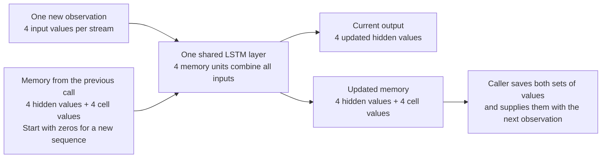
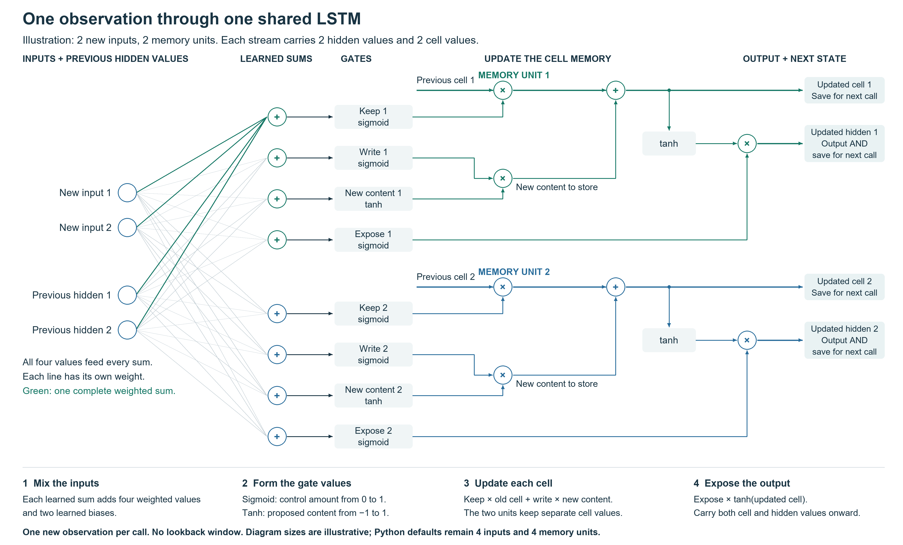
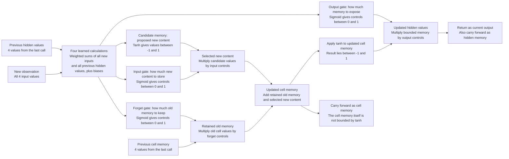

# Shared LSTM encoder — standalone variant A

The implementation is `shared_lstm.py`. It contains one standard PyTorch LSTM
layer. All features enter that same layer. The number of input values and the
number of memory units are independent settings, both defaulting to 4.

Edit `INPUT_SIZE` and `HIDDEN_SIZE` at the top of `shared_lstm.py` before
running to change the defaults. The example uses these settings and constructs
matching synthetic inputs. You can still override either size when constructing
`SharedLSTMEncoder(input_size=..., hidden_size=...)`.

## Architecture preview



This diagram uses the default sizes and shows one independent stream. A batch
processes multiple independent streams together, each with its own memory.
Each stream has eight recurrent state values inside one layer. The hidden
values are also the current output; they are not a third set of memory values.
Cell values carry the internal memory that the gates update.

**One new observation per call; no lookback window.** Previous input rows are
not collected or replayed. Only the hidden and cell values are carried forward.
The same learned layer processes each new observation, and finite memory can
still forget information.

## Operations inside the shared layer

The integrated left-to-right diagram follows every connection from incoming
values through the gates to updated cell memory and hidden output. For clarity,
the illustration uses two inputs and two memory units; the Python defaults
remain four inputs and four memory units. Both illustrated units belong to the
same shared layer. Plain-English step annotations appear below the diagram.



Every box below uses descriptive names. Each gate produces four control values
with the default memory size, one for each memory unit.



The gates are calculations within the one LSTM layer. Each has its own learned
weights and biases. Every memory unit can receive information from every input
feature and every previous hidden value.

The mathematical operations, written with descriptive names, are:

- **Each learned calculation** = input weights × new observation + hidden
  weights × previous hidden values + input bias + hidden bias.
- **Updated cell memory** = forget controls × previous cell memory + input
  controls × candidate memory.
- **Updated hidden values** = output controls × tanh(updated cell memory).

The first equation uses matrix multiplication to mix inputs. The last two
multiply corresponding values one by one, then add corresponding values.
Sigmoid smoothly maps a number into the range 0 to 1. Tanh smoothly maps a
number into the range -1 to 1. These controls are learned, continuous amounts,
not fixed on/off switches.

Source: [PyTorch LSTM reference](https://docs.pytorch.org/docs/2.14/generated/torch.nn.LSTM.html).

## Usage

`example_shared_lstm.py` constructs synthetic tensors and shows a first call,
a continuing call, and optional explicit state detachment. Each call has
input/output shape [2, 1, 4]; both final states have shape [1, 2, 4].

Run using the project-local test environment:

```powershell
.\.venv-shared-lstm\Scripts\python.exe Models/SharedLSTM/example_shared_lstm.py
.\.venv-shared-lstm\Scripts\python.exe -m unittest discover -s Models/SharedLSTM -v
```

For one-observation-at-a-time use, supply input shape
`[number of streams, 1, number of input values]`. The middle dimension of 1
means one new observation, not a lookback window. The underlying interface also
accepts consecutive chunks, but buffering a chunk is not required. Preserve
batch stream order when carrying state. Use `state=None` for an independent
sequence.

Inputs, state, and model must share device and floating-point dtype. Use
`model.to(...)` and move caller-owned tensors explicitly. The encoder does not
silently cast, move, detach, retain, or reset supplied state. Callers control
gradient tracking. `detach_state` keeps values but cuts gradient history;
its returned tensors share storage with the originals.

Normal `train()`, `eval()`, and `state_dict()` behavior is inherited from
PyTorch. Recreate the same input and hidden sizes before loading a state dict.
Standard initialization occurs at construction; units are not cloned and
different specialization is not guaranteed.
